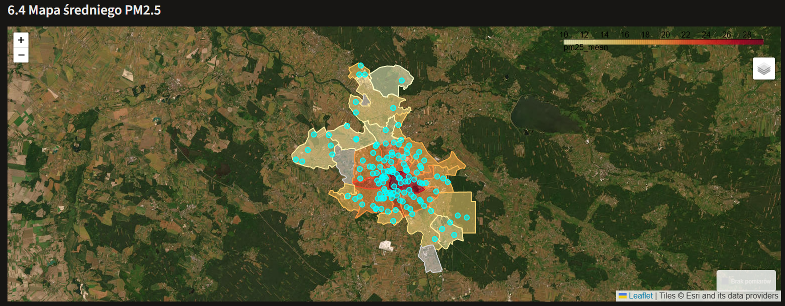
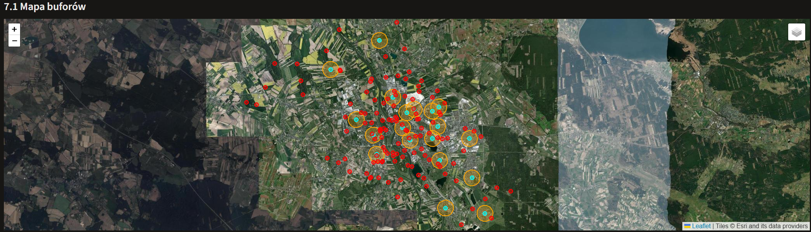
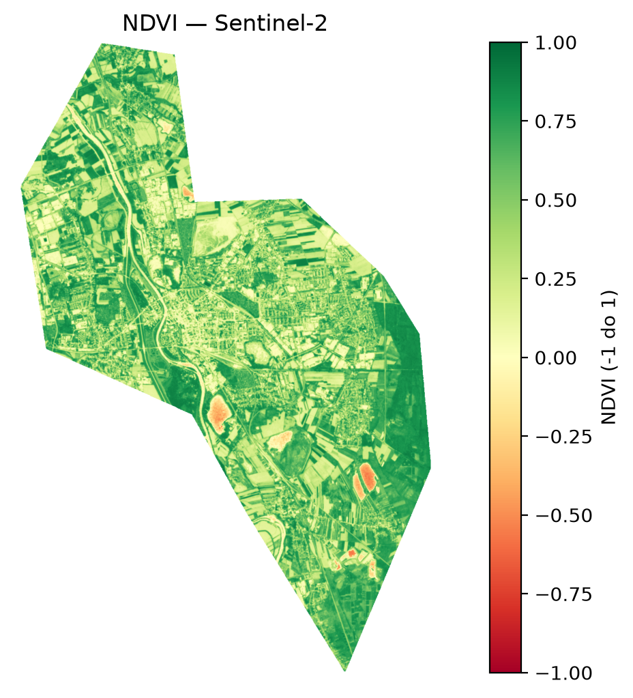
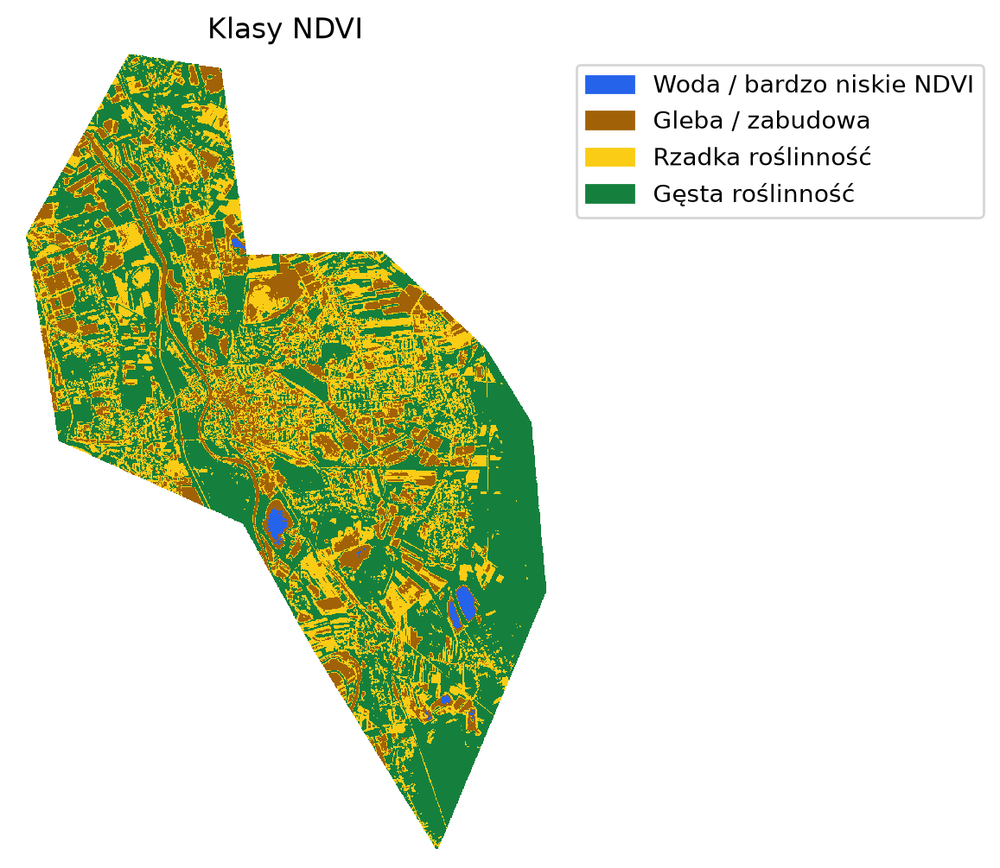
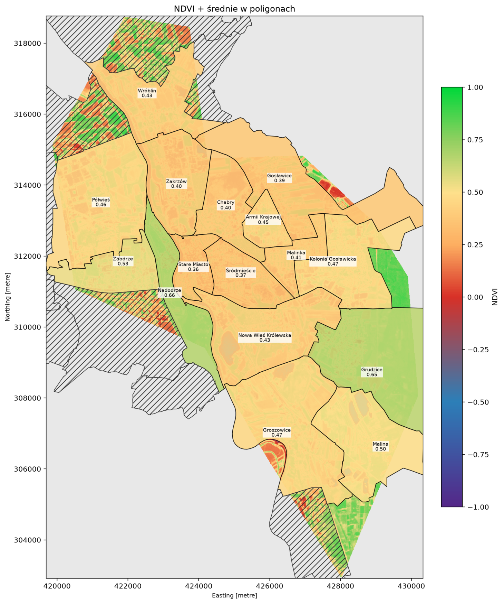

# Analiza danych przestrzennych – Pandas, GeoPandas i Rasterio

## 1. Cel ćwiczenia

Celem ćwiczenia było zapoznanie się z możliwościami bibliotek **Pandas, GeoPandas i Rasterio** w zakresie przetwarzania, analizy i wizualizacji danych przestrzennych.

Przeprowadzono analizę lokalizacji czujników PM2.5, szkół i dzielnic Opola oraz zobrazowań satelitarnych Sentinel-2. Na podstawie danych rastrowych obliczono wskaźnik NDVI, umożliwiający ocenę występowania roślinności.

Ćwiczenie wykonano w języku Python, wykorzystując środowisko PyCharm oraz bibliotekę Streamlit do stworzenia interaktywnej aplikacji internetowej.

## 2. Wykorzystane narzędzia i dane

### Narzędzia

- **PyCharm i Python** – środowisko programowania i przetwarzania danych.
- **Streamlit** – interfejs aplikacji internetowej.
- **Pandas** – analiza i czyszczenie danych tabelarycznych.
- **GeoPandas** – operacje na danych przestrzennych.
- **Rasterio i NumPy** – przetwarzanie danych rastrowych i obliczanie NDVI.
- **Folium i Matplotlib** – wizualizacja map i wykresów.

### Dane wejściowe

| Plik | Opis |
|---|---|
| `pm25_sensors.csv` | Lokalizacje i pomiary czujników PM2.5 |
| `opole_districts.geojson` | Granice dzielnic Opola |
| `opole_schools.geojson` | Lokalizacje szkół |
| `B04.tiff` | Pasmo czerwone Sentinel-2 |
| `B08.tiff` | Pasmo bliskiej podczerwieni Sentinel-2 |
| `NDVI.tiff` | Wskaźnik NDVI z Copernicus Browser |
| `True_color.tiff` | Zobrazowanie w kolorach naturalnych |

Dane Sentinel-2 L2A pochodziły z 6 października 2026 r. i obejmowały Opole oraz okolice.

## 3. Przebieg ćwiczenia

### 3.1. Przygotowanie aplikacji

Utworzono projekt Python ze środowiskiem wirtualnym. Aplikację Streamlit podzielono na dwie strony:

- `page1.py` – analiza danych Pandas i GeoPandas.
- `page2.py` – przetwarzanie danych rastrowych Rasterio.

Dane wczytywano automatycznie z lokalnego katalogu `data/`.

### 3.2. Analiza i czyszczenie danych PM2.5

Dane czujników wczytano za pomocą Pandas. Sprawdzono typy danych, statystyki opisowe, brakujące wartości i duplikaty.

Następnie usunięto nieprawidłowe rekordy oraz poprawiono zamienione współrzędne geograficzne.

```python
df = df.drop_duplicates().copy()
df = df.dropna(subset=["lat", "lon", "pm25"])

swapped = df["lat"].between(14, 24.5) & df["lon"].between(49, 55)

df.loc[swapped, ["lat", "lon"]] = (
    df.loc[swapped, ["lon", "lat"]].to_numpy()
)

df = df[df["pm25"] >= 0]
```

Po czyszczeniu pozostało **130 ze 145 rekordów**. Skorygowano również trzy pary współrzędnych.

### 3.3. Operacje przestrzenne GeoPandas

Oczyszczone dane przekształcono do obiektu `GeoDataFrame`, tworząc geometrie punktowe na podstawie współrzędnych.

```python
sensors = gpd.GeoDataFrame(
    df,
    geometry=gpd.points_from_xy(df["lon"], df["lat"]),
    crs="EPSG:4326"
)
```

Następnie wykonano transformację do układu EPSG:2180, umożliwiającego obliczenia w metrach.

W ramach analizy:

- obliczono powierzchnie dzielnic Opola,
- przypisano czujniki do dzielnic za pomocą `sjoin()`,
- wyznaczono średnie PM2.5 dla poszczególnych dzielnic,
- utworzono strefy buforowe wokół szkół,
- obliczono pokrycie miasta strefami buforowymi.

Wyniki przedstawiono na interaktywnych mapach z podkładem satelitarnym.



*Rys. 1. Mapa średniego stężenia PM2.5 w dzielnicach Opola.*



*Rys. 2. Strefy buforowe wokół szkół z zaznaczonymi czujnikami PM2.5.*

Dodatkowo przygotowano eksport wyników do formatów GeoPackage, GeoJSON i CSV.

### 3.4. Analiza danych rastrowych

W drugiej części ćwiczenia wykorzystano pasma B04 (Red) i B08 (NIR) satelity Sentinel-2.

Za pomocą Rasterio odczytano metadane rastrów, w tym rozdzielczość, CRS, transformację afiniczną oraz wartości pikseli.

Przeanalizowano podstawowe statystyki obu pasm i przedstawiono ich rozkłady na histogramach.

Następnie rastry przeliczono z EPSG:4326 do układu **EPSG:2180**, tworząc wspólną siatkę pikseli o rozdzielczości 10 × 10 metrów.

### 3.5. Obliczenie i klasyfikacja NDVI

Na podstawie pasm B04 i B08 obliczono wskaźnik NDVI:

\[
NDVI = \frac{NIR-Red}{NIR+Red}
\]

```python
with np.errstate(divide="ignore", invalid="ignore"):
    ndvi = (nir_m - red_m) / (nir_m + red_m)

ndvi = np.ma.masked_invalid(ndvi)
```

Wyniki przedstawiono w formie mapy oraz histogramu.

Następnie wartości NDVI podzielono na cztery klasy: wodę i powierzchnie o niskim NDVI, glebę i zabudowę, rzadką oraz gęstą roślinność.

Zastosowano interaktywne suwaki umożliwiające zmianę progów klasyfikacji. Dla każdej klasy obliczono liczbę pikseli i powierzchnię w hektarach.



*Rys. 3. Mapa NDVI obliczona na podstawie pasm Sentinel-2.*



*Rys. 4. Klasyfikacja NDVI z zestawieniem powierzchni poszczególnych klas.*

### 3.6. Statystyki strefowe NDVI

Ostatnim etapem było połączenie rastra NDVI z granicami dzielnic Opola.

Za pomocą `rasterio.mask.mask()` wyodrębniono piksele znajdujące się w granicach poszczególnych poligonów.

Dla każdej dzielnicy obliczono średnią, minimalną i maksymalną wartość NDVI oraz procent pokrycia obszaru poprawnymi pikselami.

Dla dzielnic o pokryciu poniżej 50% pominięto statystyki NDVI, ponieważ mogłyby być niereprezentatywne.

Wyniki przedstawiono na mapie, na której poligony pokolorowano według średniego NDVI, a obszary o niewystarczającym pokryciu oznaczono kreskowaniem.



*Rys. 5. Średnie wartości NDVI dla dzielnic Opola wraz z oznaczeniem obszarów o niewystarczającym pokryciu.*

## 4. Rezultaty

W wyniku ćwiczenia:

- Oczyszczono dane czujników PM2.5, pozostawiając 130 poprawnych rekordów.
- Wykonano analizy przestrzenne punktów i poligonów z wykorzystaniem GeoPandas.
- Obliczono powierzchnie dzielnic, średnie wartości PM2.5 oraz strefy buforowe.
- Przeprowadzono reprojekcję danych rastrowych do układu metrycznego.
- Obliczono i sklasyfikowano wskaźnik NDVI na podstawie danych Sentinel-2.
- Wyznaczono statystyki NDVI dla dzielnic Opola.
- Przygotowano interaktywne mapy, wykresy i tabele wynikowe w aplikacji Streamlit.

## 5. Wnioski

Ćwiczenie pozwoliło poznać podstawowe metody przetwarzania danych tabelarycznych, wektorowych i rastrowych w języku Python.

Wykorzystanie Pandas i GeoPandas umożliwiło oczyszczenie danych oraz przeprowadzenie analiz przestrzennych związanych z jakością powietrza. Biblioteka Rasterio pozwoliła na przetworzenie zobrazowań Sentinel-2 i obliczenie wskaźnika NDVI.

Istotnym elementem było prawidłowe przygotowanie danych, szczególnie uwzględnienie układów współrzędnych, brakujących wartości oraz zgodności siatek rastrowych.

Zastosowanie Streamlit umożliwiło przygotowanie interaktywnej aplikacji, w której zmiana parametrów analizy wpływa bezpośrednio na prezentowane wyniki.

Ćwiczenie pokazało możliwości łączenia analiz wektorowych i rastrowych w celu badania zjawisk przestrzennych i środowiskowych.