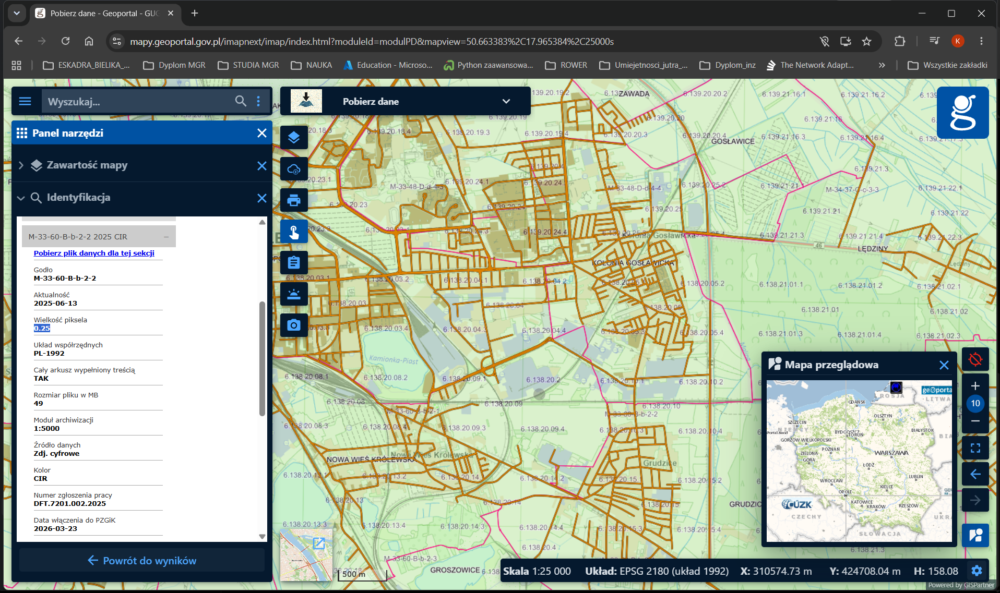
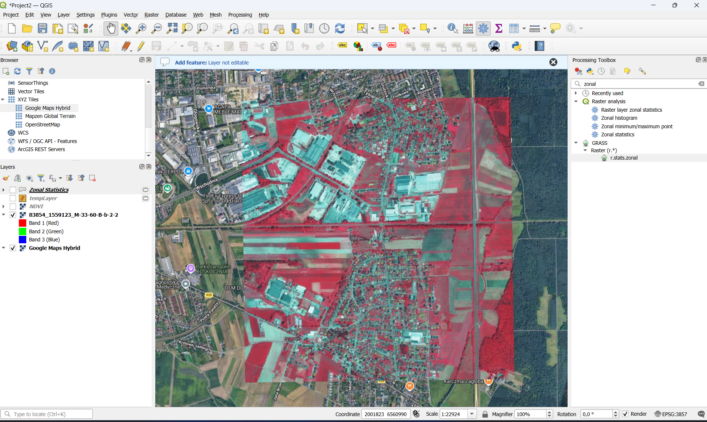
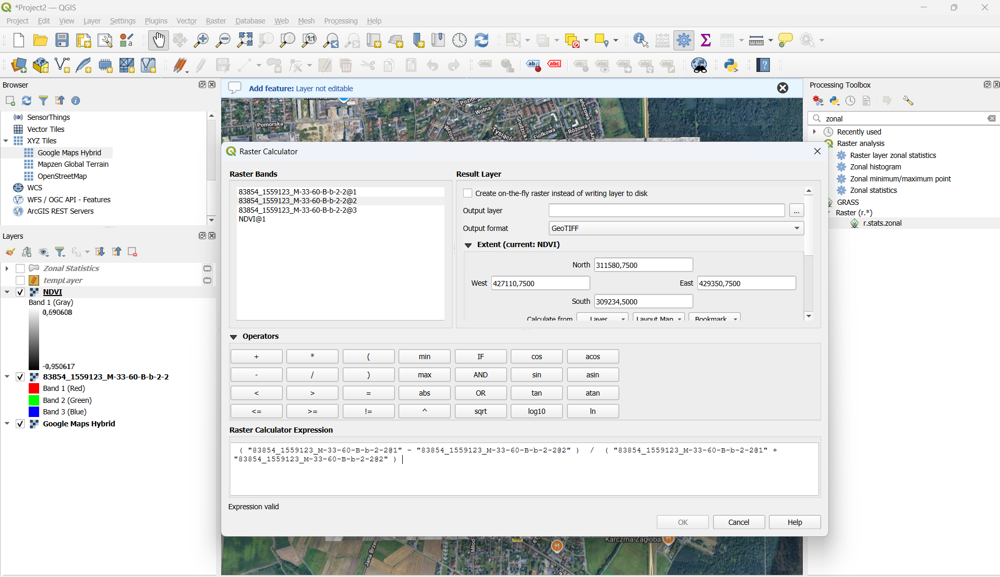
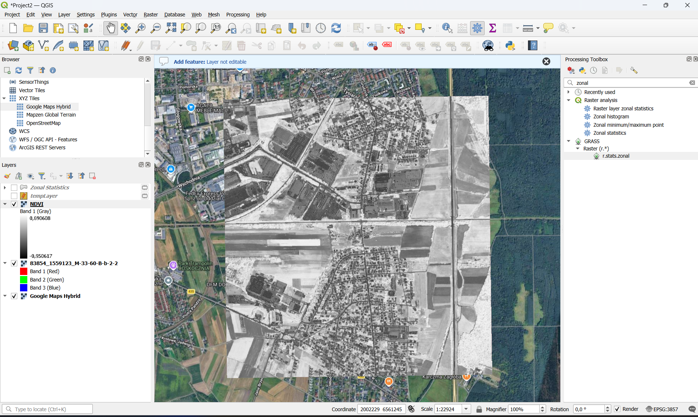
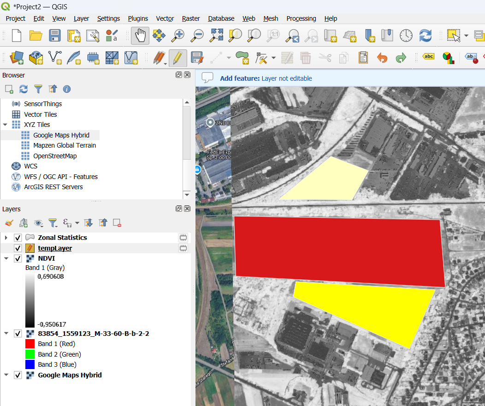
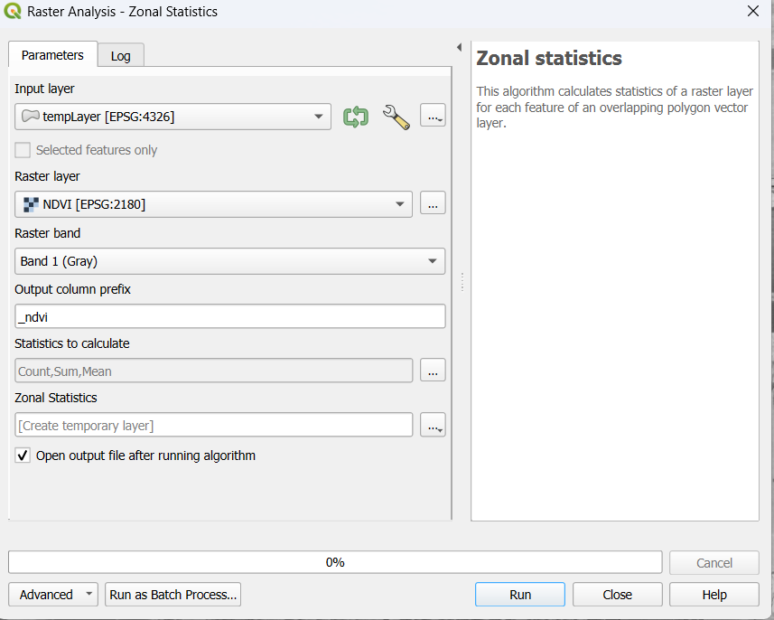
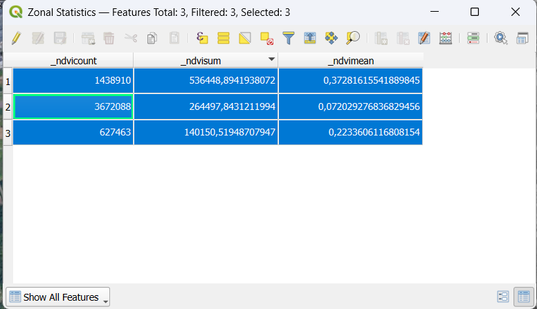
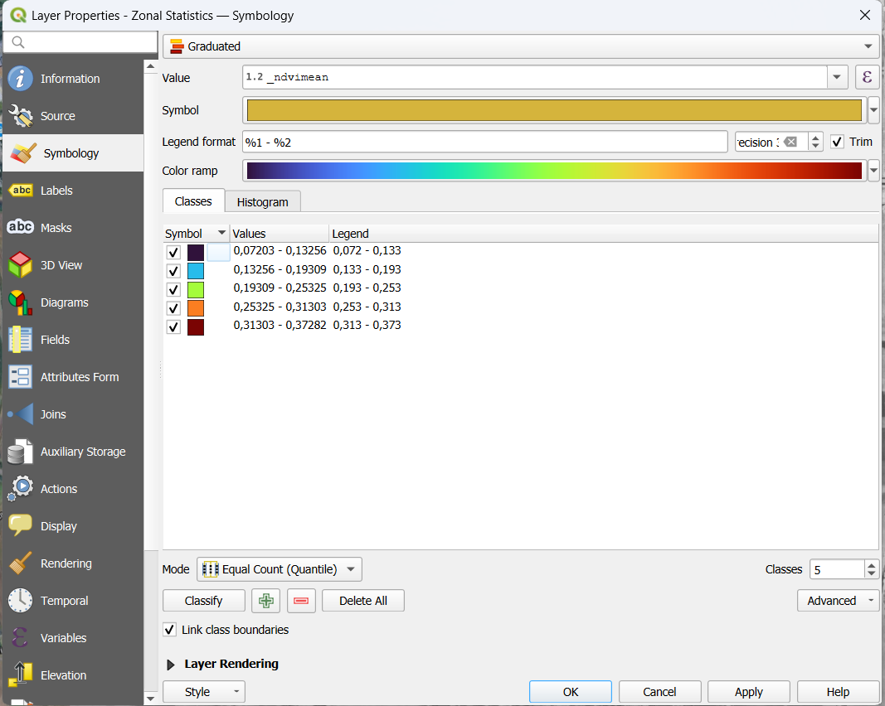

# Analiza roślinności na podstawie ortofotomapy CIR i wskaźnika NDVI w QGIS

## 1. Cel ćwiczenia

Celem ćwiczenia było obliczenie wskaźnika roślinności **NDVI** na podstawie ortofotomapy **CIR**, a następnie porównanie jego wartości w trzech wyznaczonych obszarach za pomocą statystyk strefowych.

Wykorzystano program **QGIS zainstalowany lokalnie w systemie Windows** oraz dane pobrane z **Geoportalu**.

## 2. Wykorzystane dane

| Parametr | Wartość |
|---|---|
| Obszar analizy | Wschodnia część Opola |
| Identyfikator danych | 83854_1559123_M-33-60-B-b-2-2 |
| Data wykonania zdjęć | 13.06.2025 |
| Rozdzielczość przestrzenna | 0,25 m |
| Źródło | Geoportal — ortofotomapa CIR |
| Kanał 1 | Bliska podczerwień — NIR |
| Kanał 2 | Czerwień — RED |

## 3. Przebieg ćwiczenia

### Krok 1. Pobranie danych

Na stronie [Geoportalu](https://www.geoportal.gov.pl/) wybrano **Pobierz dane**, a następnie warstwę **Dane do pobrania → Ortofotomapa → Ortofotomapa wg rozdzielczości**. Wyszukano wybrany obszar i pobrano ortofotomapę w wariancie **CIR**.

*Rys. 1. Wybrany arkusz ortofotomapy CIR.*

### Krok 2. Wczytanie ortofotomapy

Pobrany raster dodano do QGIS przez przeciągnięcie pliku do okna programu. Na obrazie CIR roślinność silnie odbijająca bliską podczerwień jest przedstawiona w czerwonych odcieniach.

*Rys. 2. Ortofotomapa CIR wczytana do QGIS.*

### Krok 3. Obliczenie NDVI

Wybrano **Raster → Kalkulator rastra** i obliczono wskaźnik:

$$
NDVI = \frac{NIR - RED}{NIR + RED}
$$

Jako **NIR** wykorzystano kanał 1 ortofotomapy, a jako **RED** — kanał 2. Wynik zapisano jako `ndvi.tif`.

*Rys. 3. Wyrażenie obliczające NDVI w kalkulatorze rastra.*

### Krok 4. Wizualizacja wyniku

*Rys. 4. Wynikowa mapa NDVI.*

### Krok 5. Utworzenie obszarów analizy

Utworzono tymczasową warstwę wektorową o nazwie **tempLayer**, wybierając typ geometrii **Polygon**. Następnie narzędziem **Add Polygon** narysowano trzy obszary przeznaczone do analizy.

*Rys. 5. Poligony wyznaczające obszary analizy.*

### Krok 6. Statystyki strefowe

W panelu **Processing Toolbox** wybrano narzędzie **Zonal Statistics**. Jako warstwę obszarów wskazano **tempLayer**, a jako raster — wynikową warstwę **NDVI**, wybierając jej kanał 1.

Obliczono statystyki dla trzech poligonów. Wyniki odczytano z tabeli atrybutów warstwy wynikowej.

*Rys. 6. Ustawienia narzędzia Zonal Statistics.*

*Rys. 7. Tabela atrybutów z wynikami analizy.*

### Krok 7. Wizualizacja średnich wartości NDVI

We właściwościach warstwy wynikowej **Zonal Statistics** otwarto zakładkę **Symbology** i wybrano sposób wyświetlania **Graduated**. W polu **Value** wskazano atrybut zawierający średnią wartość NDVI (`ndvimean`), a następnie dobrano **Color ramp**.

Wybrano **Classify**, aby utworzyć przedziały wartości, i zastosowano ustawienia. Poligony zostały pokolorowane według średniego NDVI, co ułatwiło porównanie analizowanych obszarów.

*Rys. 8. Symbolizacja stopniowana poligonów według średniej wartości NDVI.*

## 4. Wyniki

Dla trzech obszarów obliczono liczbę pikseli (`count`), sumę wartości NDVI (`sum`) oraz średnią wartość NDVI (`mean`). Numeracja obszarów odpowiada kolejności wierszy w tabeli wynikowej.

| Obszar | Liczba pikseli | Suma NDVI | Średnie NDVI |
|---|---:|---:|---:|
| Obszar 1 | 1 438 910 | 536 448,894 | 0,3728 |
| Obszar 2 | 3 672 088 | 264 497,843 | 0,0720 |
| Obszar 3 | 627 463 | 140 150,519 | 0,2234 |

Najwyższą średnią wartość NDVI uzyskano dla **obszaru 1**, a najniższą dla **obszaru 2**. Obszar 3 osiągnął wartość pośrednią. Wyniki mogą wskazywać na większy udział roślinności w obszarze 1 niż w obszarze 2, jednak wymaga to porównania z ortofotomapą.

Do porównania wykorzystano średnią wartość NDVI, ponieważ suma zależy również od liczby pikseli w danym obszarze. Nie obliczano wartości minimalnych ani maksymalnych.

## 5. Wnioski

Na podstawie ortofotomapy CIR utworzono mapę NDVI i wykonano statystyki strefowe dla trzech poligonów. Stwierdzono zróżnicowanie średnich wartości wskaźnika — od **0,0720** do **0,3728**.

Wyniki umożliwiają względne porównanie wybranych obszarów pod względem występowania roślinności. Przy ich interpretacji należy uwzględnić pokrycie terenu, cienie oraz sposób przetwarzania ortofotomapy. Bez potwierdzenia kalibracji radiometrycznej danych nie należy na ich podstawie jednoznacznie oceniać kondycji roślinności.

