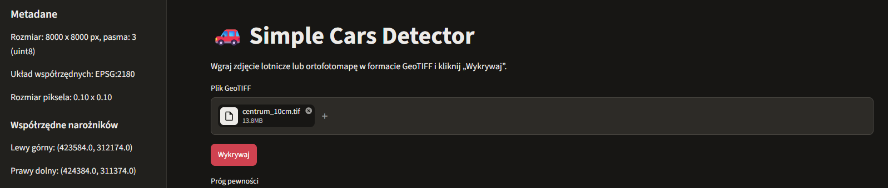
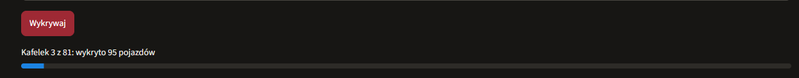
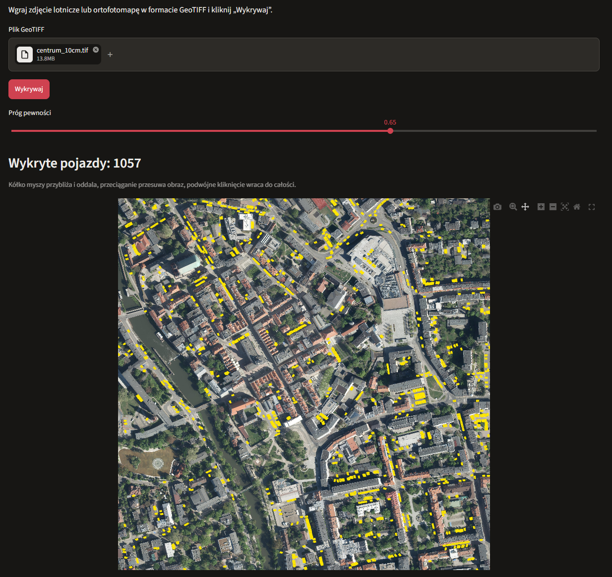
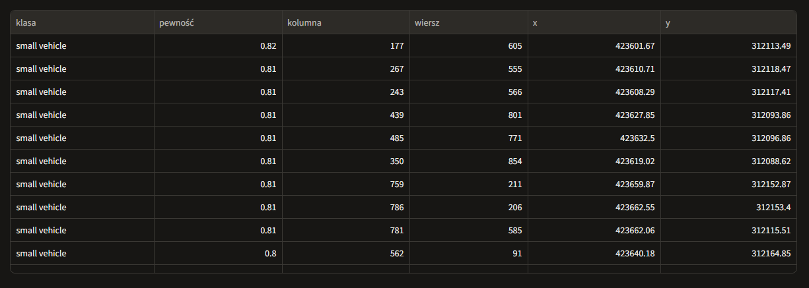

# Analiza danych przestrzennych – wykrywanie pojazdów na ortofotomapie (YOLO)

## 1. Cel ćwiczenia

Celem ćwiczenia było stworzenie aplikacji **Streamlit** do wczytywania ortofotomapy GeoTIFF, wykrywania pojazdów modelem **YOLO11n-OBB** i przedstawiania wyników na interaktywnym obrazie oraz w tabeli współrzędnych.

## 2. Wykorzystane narzędzia i dane

- **Python i PyCharm** – przygotowanie aplikacji.
- **Streamlit** – interfejs użytkownika.
- **Rasterio, NumPy i Pillow** – odczyt i przetwarzanie rastra.
- **Ultralytics YOLO11n-OBB** – wykrywanie pojazdów za pomocą obróconych ramek.
- **Plotly** – interaktywny podgląd i prezentacja wykryć.
- **Pandas** – tabela wynikowa.

**Dane wejściowe:** zdjęcie lotnicze w formacie `.tif` lub `.tiff` (GeoTIFF) oraz wagi modelu `yolo11n-obb.pt`, pobierane automatycznie przy pierwszym użyciu.

## 3. Przebieg ćwiczenia

### 3.1. Przygotowanie i uruchomienie aplikacji

Utworzono projekt Python ze środowiskiem wirtualnym i zainstalowano wymagane biblioteki:

```bash
python -m pip install streamlit numpy plotly pillow rasterio pandas ultralytics
```

Aplikację zapisaną w pliku `app.py` uruchamia się poleceniem:

```bash
streamlit run app.py
```

### 3.2. Wczytywanie i podgląd GeoTIFF

Obraz wczytywany jest przez `rasterio.io.MemoryFile`. Aplikacja odczytuje rozmiar, liczbę pasm, typ danych, układ współrzędnych (CRS), rozdzielczość i transformację rastra. W panelu bocznym wyświetlane są również **współrzędne lewego górnego i prawego dolnego narożnika**.

Obraz przekształcany jest do RGB `uint8`; dla danych innych niż 8-bitowe stosowane jest rozciągnięcie kontrastu według 2. i 98. percentyla. Plotly umożliwia przybliżanie i przesuwanie ortofotomapy. Duże obrazy są zmniejszane wyłącznie na potrzeby podglądu.

### 3.3. Detekcja pojazdów na kafelkach

Obraz dzielony jest na kafelki **1024 × 1024 px**, z zakładką **128 px**. Model `YOLO11n-OBB` analizuje każdy kafelek osobno, dzięki czemu małe pojazdy nie tracą szczegółów podczas zmniejszania całej ortofotomapy.

Z wyników pozostawiane są klasy `small vehicle` i `large vehicle`. Współrzędne ramek przeliczane są na położenie w całym obrazie, a wykrycia z nakładających się kafelków są ograniczane przez sprawdzanie położenia środka ramki. Pasek postępu informuje o liczbie przetworzonych kafelków.

### 3.4. Wizualizacja i tabela wyników

Na obrazie wyświetlane są **obrócone ramki wykrytych pojazdów**, a po najechaniu kursorem – klasa i pewność detekcji. Suwak pozwala filtrować wyniki według progu pewności (od 0,10), bez ponownego uruchamiania modelu. Wyniki zachowywane są w `st.session_state`.

Tabela Pandas zawiera klasę, pewność, pozycję środka pojazdu w pikselach oraz współrzędne `x`, `y` obliczone z transformacji GeoTIFF.

### 3.5. Dokumentacja – zrzuty ekranu

Poniższe zrzuty dokumentują kolejne etapy działania aplikacji.

**Wczytanie ortofotomapy i metadane**



*Rys. 1. Wczytana ortofotomapa oraz panel boczny z CRS, rozdzielczością i współrzędnymi narożników.*

**Wykrywanie pojazdów**



*Rys. 2. Pasek postępu podczas analizy obrazu podzielonego na kafelki.*

**Wizualizacja wyników**



*Rys. 3. Ramki wykrytych pojazdów na interaktywnym obrazie i suwak progu pewności.*

**Tabela współrzędnych**



*Rys. 4. Tabela z klasą, pewnością i współrzędnymi wykrytych pojazdów.*

## 4. Rezultaty

Przygotowano aplikację umożliwiającą wczytanie ortofotomapy, odczyt metadanych, wykrywanie pojazdów na kafelkach, regulację progu pewności i przeglądanie wyników na obrazie oraz w tabeli współrzędnych.

## 5. Wnioski

Ćwiczenie pokazało możliwość połączenia analizy danych rastrowych z detekcją obiektów przy użyciu YOLO. **Podział na kafelki** pozwala analizować duże ortofotomapy bez zmniejszania całego obrazu przed detekcją, a georeferencja umożliwia określenie położenia wykrytych pojazdów w układzie współrzędnych rastra. Wyniki zależą od jakości obrazu i przyjętego progu pewności.
