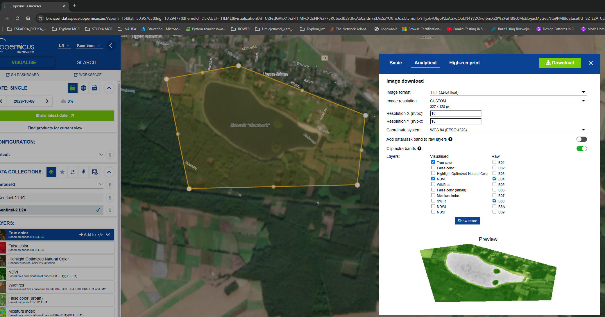
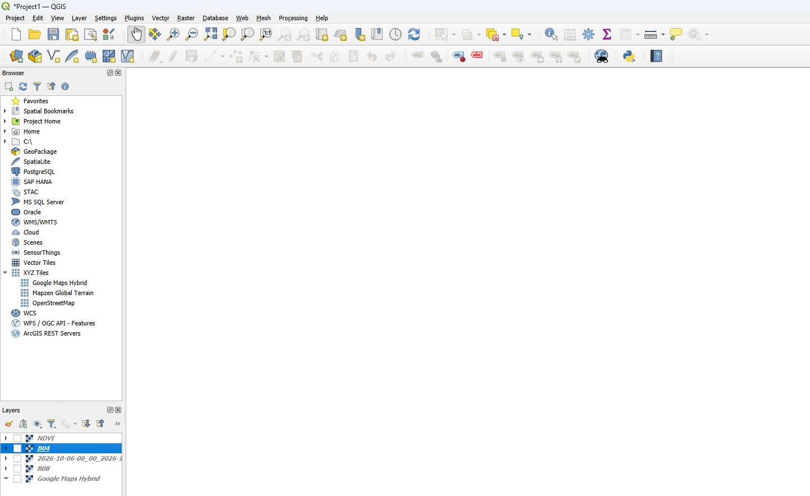
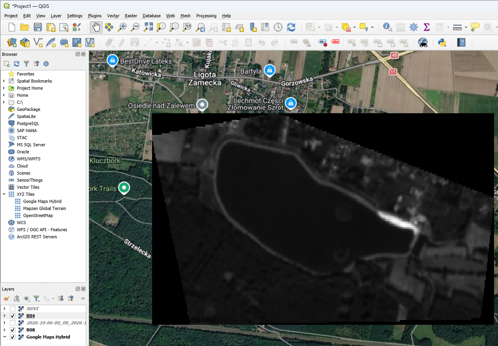
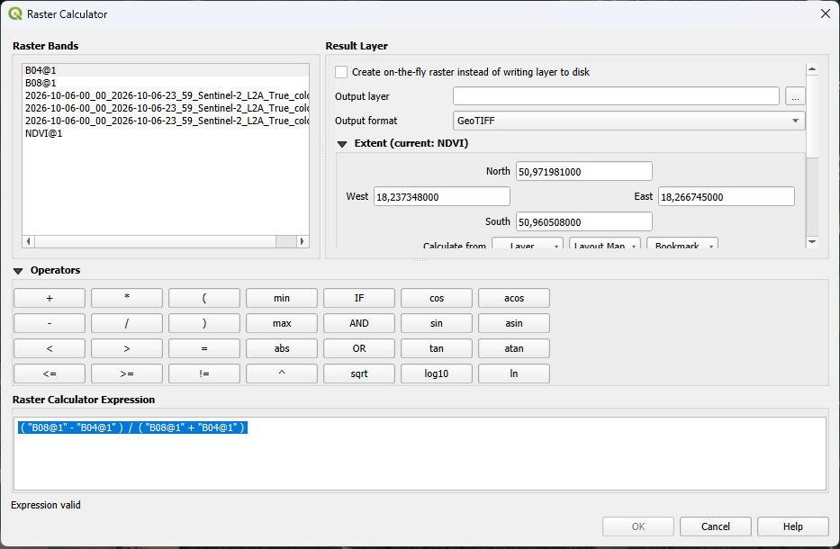
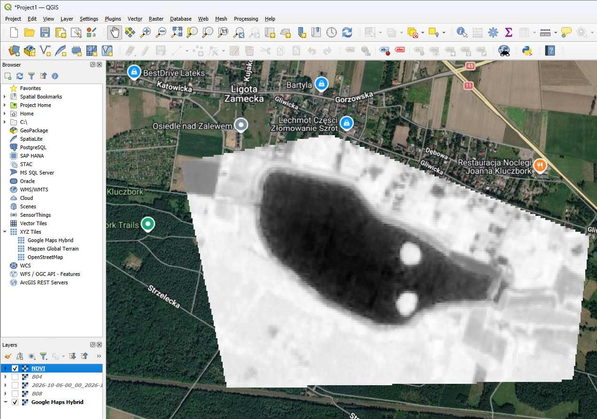

# Wyznaczanie wskaźnika NDVI na podstawie danych Sentinel-2 w QGIS

## 1. Cel ćwiczenia

Celem laboratorium było pobranie danych satelitarnych z platformy **Copernicus Data Space Ecosystem**, wczytanie pasm **B04 (RED)** i **B08 (NIR)** do programu **QGIS**, a następnie obliczenie i zwizualizowanie wskaźnika roślinności **NDVI**.

Ćwiczenie wykonałem w programie **QGIS zainstalowanym bezpośrednio w systemie Windows**, wykorzystując go do przetwarzania i wizualizacji danych rastrowych.

## 2. Wykorzystane narzędzia i dane

- **Copernicus Browser:** https://browser.dataspace.copernicus.eu/ — przeglądanie i pobranie danych satelitarnych.
- **Sentinel-2:** źródło obrazów satelitarnych.
- **QGIS (instalacja lokalna na Windows):** wczytanie rastrów, obliczenie NDVI i wizualizacja wyniku.
- **Pasma spektralne:**
  - **B04 (czerwone, RED)** — długość fali około 665 nm, rozdzielczość 10 m.
  - **B08 (bliska podczerwień, NIR)** — długość fali około 842 nm, rozdzielczość 10 m.

> **Obszar analizy:** Zalew Kluczbork
> **Data wykonania zdjęcia satelitarnego:** 06.10.2026
> **Źródło danych:** Copernicus Data Space Ecosystem / Sentinel-2

## 3. Przebieg ćwiczenia

### Krok 1. Pobranie danych satelitarnych

1. Otworzyłem stronę [Copernicus Browser](https://browser.dataspace.copernicus.eu/).
2. Zalogowałem się do platformy.
3. Wybrałem interesujący mnie obszar i scenę satelitarną Sentinel-2.
4. Pobrałem dane dla pasm **B04** i **B08** dotyczące tego samego obszaru oraz tej samej sceny.



*Rys. 1. Wybór danych satelitarnych na platformie Copernicus Browser.*

### Krok 2. Uruchomienie QGIS w systemie Windows

Uruchomiłem **lokalnie zainstalowaną aplikację QGIS w systemie Windows** i przygotowałem projekt do wczytania pobranych danych satelitarnych. Całe ćwiczenie wykonałem w tej wersji programu.



*Rys. 2. Interfejs programu QGIS.*

### Krok 3. Wczytanie pasm B04 i B08

1. Otworzyłem projekt w QGIS.
2. Dodałem pobrane pliki rastrowe jako warstwy (np. przez przeciągnięcie plików do okna QGIS lub przez **Warstwa → Dodaj warstwę → Dodaj warstwę rastrową**).
3. Sprawdziłem, czy obie warstwy są widoczne w panelu **Warstwy**.
4. Upewniłem się, że pasma obejmują ten sam obszar.



*Rys. 3. Warstwy rastrowe B04 i B08 wczytane do QGIS.*

### Krok 4. Obliczenie NDVI w kalkulatorze rastra

Z menu programu wybrałem **Raster → Kalkulator rastra** (*Raster Calculator*) i wprowadziłem wzór:

$$
NDVI = \frac{NIR - RED}{NIR + RED}
$$

gdzie:
- **NIR** — odbicie promieniowania w bliskiej podczerwieni (pasmo B08),
- **RED** — odbicie promieniowania czerwonego (pasmo B04).

Przykładowe wyrażenie w kalkulatorze rastra QGIS:

```text
("B08@1" - "B04@1") / ("B08@1" + "B04@1")
```

> Nazwy warstw w wyrażeniu muszą odpowiadać nazwom widocznym w QGIS (mogą być dłuższe niż `B04` i `B08`). Obydwa pasma muszą być ze sobą zgodne przestrzennie.

Wskazałem lokalizację pliku wynikowego, np. `ndvi.tif`, i uruchomiłem obliczenia.



*Rys. 4. Konfiguracja obliczenia wskaźnika NDVI w kalkulatorze rastra.*

### Krok 5. Wizualizacja wyniku

Po zakończeniu obliczeń do projektu została dodana warstwa wynikowa NDVI. Obejrzałem wynik na mapie. W razie potrzeby można zmienić sposób wyświetlania warstwy w **Właściwościach warstwy → Symbolizacja**, np. na pseudokolor jednopasmowy i dobrać rampę barw.



*Rys. 5. Mapa wskaźnika NDVI dla analizowanego obszaru.*

## 4. Interpretacja wskaźnika NDVI

Wskaźnik NDVI zazwyczaj przyjmuje wartości od **-1 do 1**. Orientacyjna interpretacja:

| Wartość NDVI | Przykładowa interpretacja |
|---|---|
| Poniżej 0 | Często woda, śnieg, chmury lub inne powierzchnie nieroślinne |
| 0–0,2 | Zwykle mało roślinności albo odkryta gleba i tereny zabudowane |
| 0,2–0,5 | Umiarkowana ilość roślinności |
| 0,5–1,0 | Zwykle gęsta, aktywna fotosyntetycznie roślinność |

Progi są orientacyjne; na wartości wpływają m.in. pora roku, rodzaj pokrycia terenu, zachmurzenie i sposób przygotowania danych.

## 5. Rezultat i wnioski

W ramach laboratorium:

- pobrałem dane Sentinel-2 z platformy Copernicus Browser;
- wczytałem do QGIS pasma **B04** i **B08**;
- obliczyłem wskaźnik **NDVI** za pomocą kalkulatora rastra;
- uzyskałem warstwę rastrową przedstawiającą przestrzenne zróżnicowanie wskaźnika roślinności.

**Wniosek:** dzięki połączeniu danych satelitarnych i narzędzi GIS możliwa jest analiza rozmieszczenia oraz względnej kondycji roślinności na wybranym obszarze. Wynik NDVI wymaga ostrożnej interpretacji, zwłaszcza w przypadku chmur, cieni i powierzchni bez roślinności.

## 6. Struktura plików w repozytorium

```text
lab1/
├── README.md
└── images/
    ├── 01-copernicus-browser.png
    ├── 02-qgis.png
    ├── 03-warstwy-b04-b08.png
    ├── 04-kalkulator-rastra.png
    └── 05-wynik-ndvi.png
```
